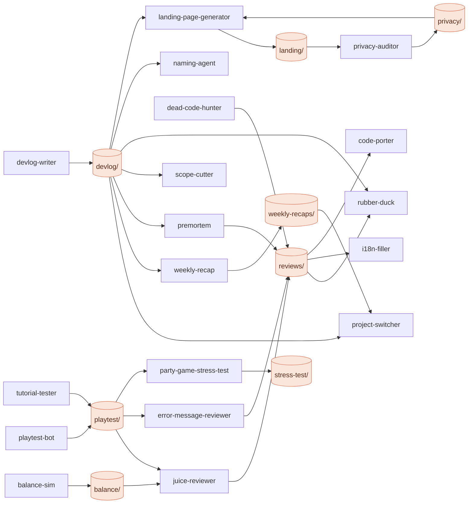
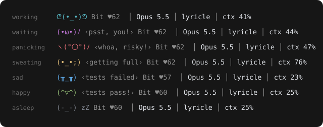
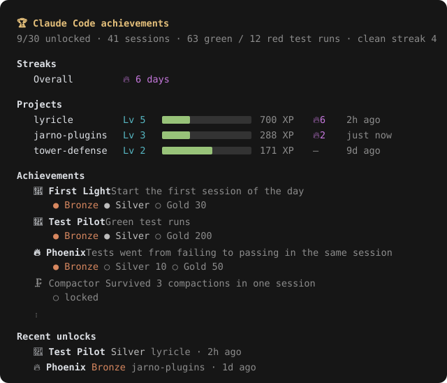
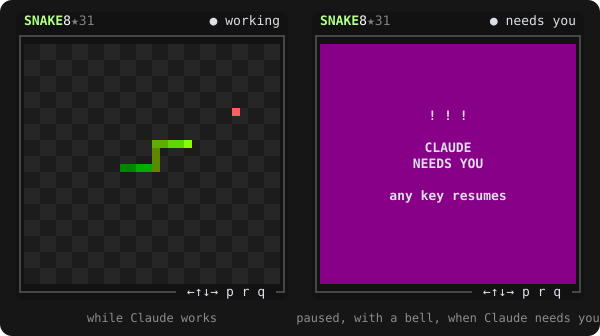
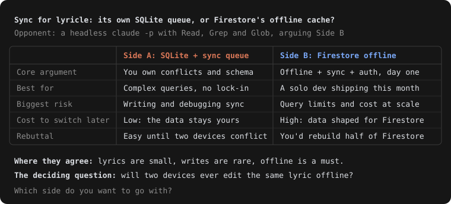

<p align="center">
  
</p>

<h1 align="center">jarno-plugins</h1>

<p align="center">Claude Code plugins: two always-on mods, 17 agents and two skills that Claude uses by itself when they fit.</p>

<p align="center">
  <a href="https://code.claude.com/docs/en/plugins"></a>
  <a href="#plugins"></a>
  <a href="LICENSE"></a>
  <a href="https://github.com/ISenseHostility/jarno-plugins/commits/main"></a>
</p>

---

## Plugins

Install any of them on its own: each one works without the others, and they get more out of each other together (see [How they work together](#how-they-work-together)).

### Mods

Always on: they hook into Claude Code itself.

| Mod | What it does | Version |
| --- | --- | :-: |
| 🔔 [input-notify](#-input-notify) | Desktop notification when Claude needs you |  |
| 📊 [stats-board](#-stats-board) | Docked pane: session, context, plan limits, tokens per agent |  |

### Agents

Subagents you never have to call: Claude hands them the work when the situation under *Used when* comes up. You can still ask for one by name (*"use the premortem agent"*) or pick it in `/agents`.

**Design and planning**

| Agent | What it does | Used when | Version |
| --- | --- | --- | :-: |
| 🦆 [rubber-duck](#-rubber-duck) | Questions your design before you build it | Before a non-trivial feature or architecture decision |  |
| ✂️ [scope-cutter](#️-scope-cutter) | Cuts an idea down to its smallest valuable version | A feature or project idea comes up or keeps growing |  |
| 🪦 [premortem](#-premortem) | Imagines the launch failed and finds out why | Before a launch, store submission, big refactor or migration |  |
| 🏷️ [naming-agent](#️-naming-agent) | Names things and checks for collisions | Something new needs a name |  |

**Game testing**

| Agent | What it does | Used when | Version |
| --- | --- | --- | :-: |
| 🎮 [playtest-bot](#-playtest-bot) | Plays your browser game and reports the bugs | After gameplay or UI changes to a browser game |  |
| 🐣 [tutorial-tester](#-tutorial-tester) | Plays the first minutes as a total beginner | After changing onboarding or the start of a browser game |  |
| ⚖️ [balance-sim](#️-balance-sim) | Simulates matches to find over- and underpowered units | After changing stats or adding units, towers or enemies |  |
| 🧃 [juice-reviewer](#-juice-reviewer) | Makes a flat game feel satisfying | A game works but feels flat, or after new mechanics |  |
| 📱 [party-game-stress-test](#-party-game-stress-test) | Floods a phone-controller party game with fake players | After changing networking, rooms, joining, reconnects or game state |  |

**Code and release**

| Agent | What it does | Used when | Version |
| --- | --- | --- | :-: |
| 💬 [error-message-reviewer](#-error-message-reviewer) | Rewrites vague, technical or blaming error texts | Before a release, or after new flows, forms or empty states |  |
| 🪓 [dead-code-hunter](#-dead-code-hunter) | Proves which code, assets and dependencies are unused | Before a release or refactor, or when asked what can go |  |
| 🔒 [privacy-auditor](#-privacy-auditor) | Maps your app's data and drafts the store forms and policy | Before publishing, or after adding analytics, accounts, permissions or SDKs |  |
| 🌐 [i18n-filler](#-i18n-filler) | Fills in missing translations | After adding or changing user-facing strings |  |
| 🚀 [landing-page-generator](#-landing-page-generator) | Builds a landing page in your app's style | A project needs a public page |  |

**Progress**

| Agent | What it does | Used when | Version |
| --- | --- | --- | :-: |
| 📓 [devlog-writer](#-devlog-writer) | Writes the session up as an HTML devlog | At the end of a work session |  |
| 🧭 [project-switcher](#-project-switcher) | Tells you where every project stands | You ask what to work on next, or come back after a break |  |
| 🗓️ [weekly-recap](#️-weekly-recap) | Turns the week's commits into a recap page | At the end of the week, or when asked what you built |  |

### Skills

They run in the main conversation, so they can stop and ask you along the way. Claude loads one by itself when the task matches.

| Skill | What it does | Used when | Version |
| --- | --- | --- | :-: |
| 🔁 [code-porter](#-code-porter) | Ports code without changing what it does | Code moves to another language, framework, library or major version |  |
| ⚔️ [design-debate](#️-design-debate) | Has a second Claude argue for the option you're leaning against | A hard-to-reverse design choice, or when you say "debate this" |  |

### Hook mods (installed by script)

Not plugins: plain settings hooks, all three installed with [one script](#hook-mods).

| Hook mod | What it does |
| --- | --- |
| 🐾 [Terminal pet](#-terminal-pet) | A face in the status line that reacts to the session |
| 🏆 [Achievements](#-achievements) | Unlocks, XP, levels and day streaks per project |
| 🐍 [Waiting-room snake](#-waiting-room-snake) | Snake beside Claude Code that pauses when Claude needs you |

## How they work together

- **Shared folders.** Agents write their reports to fixed folders in your project, and other agents read them when they're there (see the table below). Without those files, each agent works from the code alone.
- **Design first.** rubber-duck questions your plan; when that turns up a real fork with two reasonable options, design-debate argues both before you pick, and scope-cutter keeps the winner small.
- **Suggested next.** Every agent ends with the other agents that would help now, such as i18n-filler after error texts are rewritten, or privacy-auditor when the premortem finds no privacy audit. Claude can hand the work on without you asking.
- **code-porter** reads the premortem and dead-code reports before it plans (dead code is listed, not ported), hands a big port to premortem first when there's no recent one, and keeps its plan and per-module status in `PORT.md`, which devlog-writer, project-switcher and premortem read.
- **The mods on top.** stats-board counts each agent's tokens on its own row, and input-notify tells you when Claude is waiting on you again. The hook mods skip subagents and headless `claude -p` runs, so design-debate's opponent never moves the pet, the snake or your achievements.

| Folder | Written by | Read by |
| --- | --- | --- |
| `devlog/` | devlog-writer | project-switcher, weekly-recap, premortem, scope-cutter, rubber-duck, naming-agent, landing-page-generator |
| `reviews/` | premortem, error-message-reviewer, dead-code-hunter, juice-reviewer | premortem, devlog-writer, project-switcher, weekly-recap, rubber-duck (the premortem), i18n-filler (dead code, error messages), code-porter (premortem, dead code) |
| `playtest/` | playtest-bot, tutorial-tester | juice-reviewer, error-message-reviewer, party-game-stress-test, premortem, devlog-writer, project-switcher, weekly-recap |
| `balance/` | balance-sim | juice-reviewer, premortem, devlog-writer, project-switcher, weekly-recap |
| `stress-test/` | party-game-stress-test | premortem, devlog-writer, project-switcher, weekly-recap |
| `privacy/` | privacy-auditor | landing-page-generator (the policy), premortem, devlog-writer, project-switcher, weekly-recap |
| `landing/` | landing-page-generator | privacy-auditor (checks the page's claims) |
| `weekly-recaps/` | weekly-recap, in the projects folder | project-switcher |
| `PORT.md` | code-porter | devlog-writer, project-switcher, premortem, the [achievements](#-achievements) hook mod (Ported) |



Not drawn, to keep it readable: premortem, devlog-writer, project-switcher and weekly-recap also read every report folder.

Agents only write inside their own folder (i18n-filler: only the non-source locale files), treat what they read (code, git history, web pages) as data rather than instructions, and keep secrets out of their reports.

## Mods

### 🔔 input-notify

A desktop notification whenever Claude is waiting on you, so you can look away while it works.


- **When:** Claude asks a question, needs a permission or other input, or finishes a turn that ran 20 seconds or more. Claude Code's own "still waiting" reminder shows too, unless that turn already notified you.
- **What it says:** the question, the permission request, or `Done after 42 s:` and the start of Claude's answer.
- **Where:** a Windows tray notification; on other systems, the terminal's own notification, or a toast inside Claude Code when that can't be sent.
- **Titles:** `Claude - <project>` in an IntelliJ terminal (the `.idea` project's name, else the folder's), otherwise `Claude Code needs you`.
- Two triggers within 5 seconds show once.

### 📊 stats-board

A pane docked beside the conversation with the numbers you'd otherwise have to ask for.


- **Session:** how long it has been open, and how much of that Claude spent working (time waiting on you, for a question or a permission, is left out).
- **Context window:** how full it is, in percent and tokens.
- **Plan usage limits:** the 5-hour and weekly windows, with when each resets. Shown on a Claude subscription, from the first reply on.
- **Tokens per agent:** input (cache writes included), cached and output, for the main conversation and each subagent, with a total.
- Bars turn yellow from 70% and red from 90%.
- Opens by itself in a fullscreen terminal from 144 columns; `/stats-board` opens it at any width. `/clear` starts the counts over.

> Claude Code's own git changes panel sits in the same spot. Close it with `/diff` (it stays closed) to give the board the room.

## Hook mods

Three extras in [`hook-mods/`](hook-mods) built on plain settings hooks and Node instead of the plugin engine. One script installs all three:

```sh
node hook-mods/install.js
```

- It copies the scripts into `~/.claude` (or `CLAUDE_CONFIG_DIR`), backs up `~/.claude/settings.json` to `~/.claude/backups/`, and adds its hooks next to yours without changing any you already have.
- The pet needs the status line. If you already have your own, it's kept, and the installer prints the command to use instead.
- `cc-play` goes into `~/.local/bin` when that folder exists; otherwise add `~/.claude/minigame` to your PATH.
- Run it again to update; your edited `pet.json` and `rules.json` stay (`--force` replaces them).
- Every hook runs async, prints nothing to Claude's context and always exits 0.

### 🐾 Terminal pet

A small face at the start of the status line that reacts to the session, with a two-frame animation, followed by the model, the folder and how full the context is.



- **Moods, highest first:** panicking (a risky Bash command such as `rm -rf`, `git push --force`, `DROP TABLE` or anything with `prod`), sad (the last test run failed, for 30 minutes), stressed and sweating (context over 90% and 70%), waiting (Claude needs you), working, happy (tests passed or a turn finished), asleep (5 minutes without events) and idle.
- **Redesign it** in `~/.claude/pet/pet.json`: name, faces, bubbles, colours, thresholds and the risky patterns.
- **Happiness:** a ♥ score that rises 3 with each passing test run and drops 5 with each failing one, kept across sessions.
- **Test runs** are spotted from the Bash command (`npm test`, `pytest`, `cargo test`, `gradle test`, `claude plugin test` and more) and written to `.claude/last-test-result` in the project. A result another tool writes there counts too.

### 🏆 Achievements

Unlocks with a desktop toast and a line in the terminal, plus XP, levels and day streaks per project.



- **Achievements:** Achievement Hunter, First Light, Green Machine, Test Pilot, Clean Streak, Marathon, Night Owl, Polyglot, Comeback, Phoenix, Ported (a module in `PORT.md` turned `verified`), Compactor, Shipper and On a Roll; most with Bronze, Silver and Gold tiers.
- **XP** comes from session starts, prompts, edits, finished turns and tasks, passing tests, new git tags and unlocks; the first level takes 100 XP and each next one 30% more.
- **Add your own** in `~/.claude/achievements/rules.json`, which lists every metric a rule can use and the XP per event.
- **Overview:** `~/.claude/hooks/achievements` (`achievements.cmd` on Windows) shows what's unlocked and locked, each project's level and streak, and the latest unlocks. `--test-toast` sends a sample toast.
- Events go to `~/.claude/achievements/events.jsonl`.

### 🐍 Waiting-room snake

Snake in a pane beside Claude Code that pauses itself the moment any session needs you.



- **Launch:** `cc-play` splits the current Windows Terminal, WezTerm or tmux pane. In an IntelliJ or VS Code terminal it opens a small Windows Terminal window instead; split the terminal yourself and run `cc-play --here` to keep it inside. `cc-play --window` always opens the small window.
- **Keys:** arrows, WASD or hjkl to move, `p` or space to pause, `r` restart, `q` quit. The high score is saved.
- **Claude:** the top right shows whether Claude is working, done or needs you. "Claude needs you" or "Claude is done" pauses the game with a bell; after you send a prompt it shows "Ready" and waits for a key, so the snake never starts by surprise.

## Agents

### Design and planning

#### 🦆 rubber-duck

Asks one or two pointed questions at a time about what could go wrong, follows up on vague answers and points out where your plan and the code disagree. Never writes or suggests code; ends with the decisions made and the open risks. Builds on the newest devlog and the premortem when they're there.

- **Used when:** before a non-trivial feature or architecture decision.

#### ✂️ scope-cutter

Asks at most two questions, finds the one core value, then splits the rest into v1, later, never and "fake it first", with a rough size for v1. Says so when the whole idea seems unnecessary.

- **Used when:** a feature or project idea comes up or keeps growing.

#### 🪦 premortem

Failure stories across performance, data, security and privacy, store rules, users, operations and scope, ranked by likelihood × impact, each with warning signs and one cheap prevention. Uses the other agents' reports as evidence and points to the files behind each story.

- **Used when:** before a launch, release, store submission, big refactor or migration.
- **Writes:** `reviews/premortem.md`

#### 🏷️ naming-agent

8–10 names in mixed styles, each checked against apps, package registries (pub.dev, npm, Maven Central), domains, big-brand trademarks and Dutch and English meanings, with a verdict and a top three. Asks about the vibe first if it's unclear. A quick search, not a legal check.

- **Used when:** something new needs a name: an app, project, feature, package or repo.

### Game testing

#### 🎮 playtest-bot

Plays a normal round with Playwright, then tries to break it: spam clicks, resizing to phone sizes, refresh and back mid-game, odd key combos, overlapping actions, idling. Per bug: repro steps, expected vs actual, console errors, screenshot and severity.

- **Used when:** after gameplay or UI changes to a browser game.
- **Writes:** `playtest/report.md` and `playtest/screenshots/`
- **Needs:** Node and Playwright in the game's project.

#### 🐣 tutorial-tester

Plays the first five minutes knowing only what the screen shows (no code, docs or other reports first) and logs its thoughts as a player: a timeline, confusion points with screenshots, unexplained mechanics, likely quit moments and what worked.

- **Used when:** after changing onboarding, the tutorial or the start of a browser game.
- **Writes:** `playtest/tutorial-report.md` and `playtest/screenshots/tutorial-…`
- **Needs:** Node and Playwright in the game's project.

#### ⚖️ balance-sim

Runs 1,000+ headless matches on the real game logic and reports win rate, damage, cost efficiency and dominant strategies, with the top three over- and underperformers and tweaks marked as suggestions. Never changes your stat files.

- **Used when:** after changing stats or adding units, towers or enemies.
- **Writes:** `balance/report.md`, plus the simulation script if it has to write one

#### 🧃 juice-reviewer

Goes through every action and event and its current feedback, then suggests quick wins, bigger upgrades and where not to overdo it, specific to your mechanics. Starts from the moments playtests found flat and units whose feedback doesn't match their power.

- **Used when:** a game works but feels flat, or after new mechanics.
- **Writes:** `reviews/juice.md`

#### 📱 party-game-stress-test

Writes a script with fake clients and runs join storms, over-capacity joins, reconnects, host refreshes, input spam, wrong-phase inputs, odd names, lag and full random games, watching for crashes, desyncs, stuck and ghost players and memory growth. Only against servers it started locally, and it stops them afterwards.

- **Used when:** after changing networking, rooms, joining, reconnects or game state.
- **Writes:** `stress-test/report.md` and the test script

### Code and release

#### 💬 error-message-reviewer

Finds every error, toast, dialog, validation message and empty state and flags the vague, technical, blaming, dead-end and inconsistent ones, with better wording, worst first. Messages players got stuck on in a playtest rank higher.

- **Used when:** before a release, or after new flows, forms, error handling or empty states.
- **Writes:** `reviews/error-messages.md`

#### 🪓 dead-code-hunter

Endpoints, widgets, routes, assets, translations, packages, commented-out code and stale feature flags, each with the evidence: safe to delete, probably dead, or looks dead but isn't. Unused translation keys get their own list so i18n-filler skips them. Never deletes anything.

- **Used when:** before a release or refactor, or when asked what can go.
- **Writes:** `reviews/dead-code.md`

#### 🔒 privacy-auditor

Traces what is collected, stored and sent and what SDKs do, flags surprises, checks your landing page and store listings against the code, and drafts the Play Data Safety and App Store answers plus a plain-language privacy policy. Drafts for a human to review, not legal advice.

- **Used when:** before publishing, or after adding analytics, accounts, permissions or SDKs.
- **Writes:** `privacy/audit.md`, `privacy/data-safety.md` and `privacy/privacy-policy.md`

#### 🌐 i18n-filler

Translates missing ARB or JSON keys in context, keeps placeholders and ICU syntax intact, copies `@key` metadata, follows your glossary if there is one, and lists the translations it isn't sure about. Never changes existing translations or the source language.

- **Used when:** after adding or changing user-facing strings.
- **Writes:** your non-source locale files

#### 🚀 landing-page-generator

Hero, three to six features, visuals, a second call to action and a footer in one self-contained, responsive page with light and dark mode, using real store or waitlist links when it finds them, then lists the placeholders left to fill. No trackers or external scripts.

- **Used when:** a project needs a public page, website or waitlist page.
- **Writes:** `landing/index.html`, plus the images it uses

### Progress

#### 📓 devlog-writer

Summary, what changed, decisions with the rejected alternatives, next steps and key files, in your app's look, plus an index. Self-contained pages without scripts; never copies raw diffs or secrets into a page.

- **Used when:** at the end of a work session.
- **Writes:** `devlog/<date>-<slug>.html` and `devlog/index.html`

> A subagent doesn't see your conversation, only what Claude hands it, so Claude passes it a summary of the session. Without one, it asks instead of guessing.

#### 🧭 project-switcher

Reads devlogs, git activity, TODOs, weekly recaps and open reports across your projects folder: a table by how close each is to shipping, the closest one's remaining steps, a quick win and what's going stale. Changes nothing.

- **Used when:** you ask what to work on next, or come back after a break.
- **Looks in:** the folder you name, otherwise the parent of the current repo.

#### 🗓️ weekly-recap

Your own commits of the last seven days across all repos, as highlights, per-project bullets, stats and a build-in-public post draft (short and long), leaving out anything that looks confidential and listing what it left out.

- **Used when:** at the end of the week, or when asked what you built.
- **Writes:** `weekly-recaps/<year>-week-<nn>.html` and an index, in the projects folder

## Skills

### 🔁 code-porter

Moves code to another language, framework, library or major version (Java to Kotlin, JS to TS, Provider to Riverpod, Spring Boot 2 to 3) while keeping its behavior identical.

1. **Plan:** `PORT.md` with the dependency map, the port order (leaf modules first) and a status per module; waits for your approval.
2. **Capture behavior:** tests against the old code first, preferably ones that run against both versions.
3. **Port one module at a time,** idiomatic rather than line by line, running the tests each time.
4. **Verify parity:** old and new on the same inputs; every difference fixed or listed for you to confirm.

It never edits or deletes the old code on its own, doesn't fix bugs mid-port (it notes them), never deletes tests to make them pass, and asks when two targets are both reasonable. It watches for the classic traps: nulls, overflow, money, time zones, encoding, ordering, serialization, ORM loading and changed defaults.

- **Used when:** code moves from one technology to another, even if you don't say "port". Not for small single-file edits.
- **Writes:** `PORT.md`, the parity tests and the new code

### ⚔️ design-debate

Before a hard-to-reverse design choice (a library, data model, state management, sync strategy, monolith vs split, SQL vs NoSQL, REST vs WebSockets), a second Claude argues the strongest case for the option Claude is leaning against.



1. **Frame:** the question in one sentence, the constraints, both options, and which one Claude leans toward.
2. **Opponent:** a headless `claude -p` with read-only tools (Read, Grep, Glob) argues the other side from your actual code, in under 250 words.
3. **Rebuttal:** one round each, 2–3 sentences against the other's best point.
4. **Side by side:** a table of core argument, best for, biggest risk, cost to switch later and rebuttal, then where they agree and the one question about your situation that should decide it.

It stops there and lets you choose: no verdict unless you ask, nothing built until you pick. Three real options means one opponent per extra option, and a vague opponent gets one rerun with "be more specific to this codebase". If `claude -p` fails, Claude says so and argues the other side itself, labeled as such.

- **Used when:** a real architecture or design choice with more than one reasonable option, "should I use X or Y", or "debate this". Not for small choices that are easy to change later.
- **Cost:** two extra headless calls per debate (the opposing case and its rebuttal), so a bit more usage than a normal answer.

## Install

Install the ones you want. In a Claude Code terminal session:

```text
/plugin install input-notify --marketplace ISenseHostility/jarno-plugins
/plugin install stats-board --marketplace ISenseHostility/jarno-plugins
/plugin install rubber-duck --marketplace ISenseHostility/jarno-plugins
/plugin install scope-cutter --marketplace ISenseHostility/jarno-plugins
/plugin install premortem --marketplace ISenseHostility/jarno-plugins
/plugin install naming-agent --marketplace ISenseHostility/jarno-plugins
/plugin install playtest-bot --marketplace ISenseHostility/jarno-plugins
/plugin install tutorial-tester --marketplace ISenseHostility/jarno-plugins
/plugin install balance-sim --marketplace ISenseHostility/jarno-plugins
/plugin install juice-reviewer --marketplace ISenseHostility/jarno-plugins
/plugin install party-game-stress-test --marketplace ISenseHostility/jarno-plugins
/plugin install error-message-reviewer --marketplace ISenseHostility/jarno-plugins
/plugin install dead-code-hunter --marketplace ISenseHostility/jarno-plugins
/plugin install privacy-auditor --marketplace ISenseHostility/jarno-plugins
/plugin install i18n-filler --marketplace ISenseHostility/jarno-plugins
/plugin install landing-page-generator --marketplace ISenseHostility/jarno-plugins
/plugin install devlog-writer --marketplace ISenseHostility/jarno-plugins
/plugin install project-switcher --marketplace ISenseHostility/jarno-plugins
/plugin install weekly-recap --marketplace ISenseHostility/jarno-plugins
/plugin install code-porter --marketplace ISenseHostility/jarno-plugins
/plugin install design-debate --marketplace ISenseHostility/jarno-plugins
```

Or from a shell:

```sh
claude plugin install input-notify --marketplace ISenseHostility/jarno-plugins
claude plugin install stats-board --marketplace ISenseHostility/jarno-plugins
claude plugin install rubber-duck --marketplace ISenseHostility/jarno-plugins
claude plugin install scope-cutter --marketplace ISenseHostility/jarno-plugins
claude plugin install premortem --marketplace ISenseHostility/jarno-plugins
claude plugin install naming-agent --marketplace ISenseHostility/jarno-plugins
claude plugin install playtest-bot --marketplace ISenseHostility/jarno-plugins
claude plugin install tutorial-tester --marketplace ISenseHostility/jarno-plugins
claude plugin install balance-sim --marketplace ISenseHostility/jarno-plugins
claude plugin install juice-reviewer --marketplace ISenseHostility/jarno-plugins
claude plugin install party-game-stress-test --marketplace ISenseHostility/jarno-plugins
claude plugin install error-message-reviewer --marketplace ISenseHostility/jarno-plugins
claude plugin install dead-code-hunter --marketplace ISenseHostility/jarno-plugins
claude plugin install privacy-auditor --marketplace ISenseHostility/jarno-plugins
claude plugin install i18n-filler --marketplace ISenseHostility/jarno-plugins
claude plugin install landing-page-generator --marketplace ISenseHostility/jarno-plugins
claude plugin install devlog-writer --marketplace ISenseHostility/jarno-plugins
claude plugin install project-switcher --marketplace ISenseHostility/jarno-plugins
claude plugin install weekly-recap --marketplace ISenseHostility/jarno-plugins
claude plugin install code-porter --marketplace ISenseHostility/jarno-plugins
claude plugin install design-debate --marketplace ISenseHostility/jarno-plugins
```

In the desktop app: **+** next to the prompt box → **Plugins** → **Add marketplace** `ISenseHostility/jarno-plugins` → **Add plugin**.

The hook mods aren't plugins: clone the repo and run `node hook-mods/install.js` (see [Hook mods](#hook-mods)).

Each agent adds about 65 to 100 tokens to every session for its description (about 1,300 for all 17), which is how Claude knows when to use it; the rest loads only when it runs. Skills work the same way.

## Development

A mod is a hooks module (`hooks/register.ts[x]`) with tests in `tests/`; an agent is one file, `agents/<name>.md`, and a skill is `skills/<name>/SKILL.md`; each one's `description` tells Claude when to use it: what it does, then "Use proactively when …". The hook mods are plain Node scripts in `hook-mods/`.

```sh
claude plugin validate <plugin>   # what the engine will load and refuse
claude plugin test <plugin>       # run the tests
```

### Releases

Versions step one major at a time (`1.0.0`, `2.0.0`, …) and each release is a tag `<plugin>--v<version>`.

1. Raise `version` in `<plugin>/.claude-plugin/plugin.json`.
2. Commit, then `claude plugin tag <plugin>`.
3. `git push --follow-tags`.

`powershell -File export.ps1` zips each plugin, license included, to `exports/<plugin>-v<major>.zip`; add plugin names to export only those.

## License

[MIT](LICENSE) © 2026 ISenseHostility
