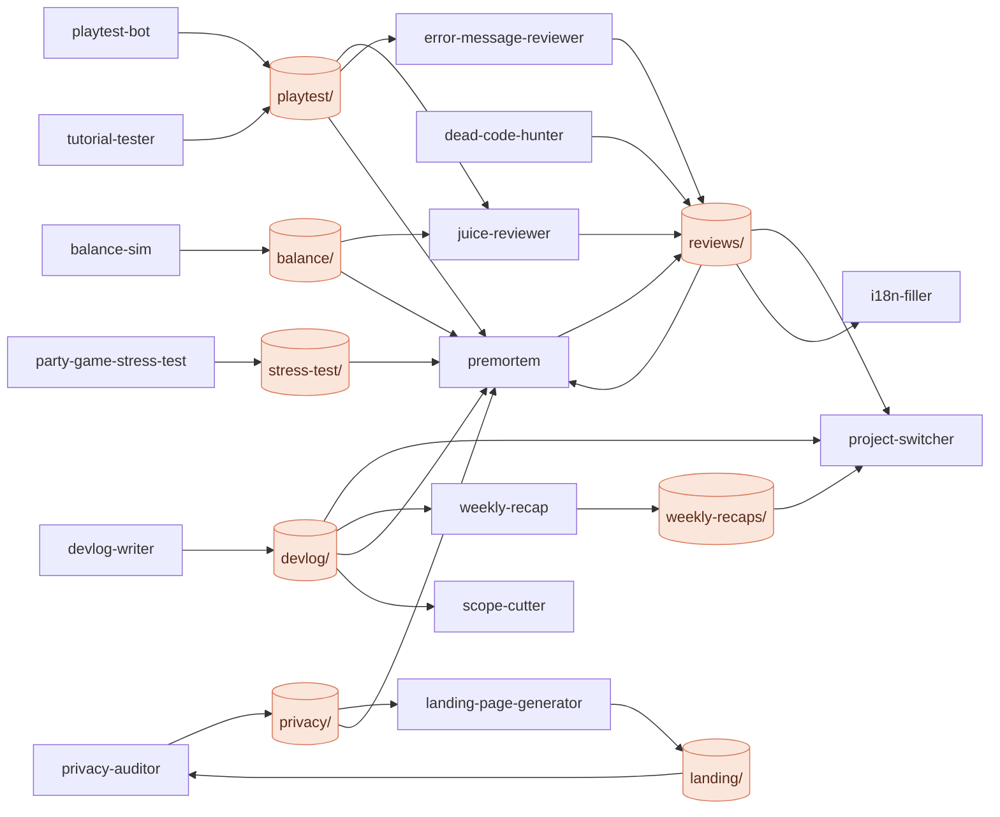
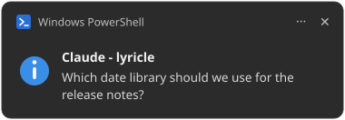
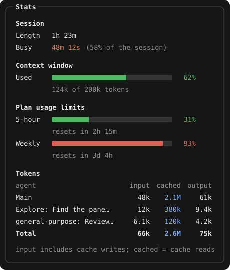

<p align="center">
  
</p>

<h1 align="center">jarno-plugins</h1>

<p align="center">Claude Code plugins: two always-on mods, 17 agents and a skill that Claude uses by itself when they fit.</p>

<p align="center">
  <a href="https://code.claude.com/docs/en/plugins"></a>
  <a href="#plugins"></a>
  <a href="LICENSE"></a>
  <a href="https://github.com/ISenseHostility/jarno-plugins/commits/main"></a>
</p>

---

## Plugins

Install any of them on its own: each one works without the others, and they get more out of each other together (see [How they work together](#how-they-work-together)).

**Mods** hook into Claude Code itself and are always on.

| | Plugin | Version | What it does |
| --- | --- | --- | --- |
| 🔔 | [input-notify](#-input-notify) |  | Desktop notification when Claude needs you |
| 📊 | [stats-board](#-stats-board) |  | Docked pane: session, context, plan limits, tokens |

**Agents** are subagents. You never have to call them: Claude hands them the work when the situation under *Used when* comes up. You can still ask for one by name (*"use the premortem agent"*) or pick it in `/agents`.

| | Agent | Version | What it does | Used when |
| --- | --- | --- | --- | --- |
| 🦆 | [rubber-duck](#-rubber-duck) |  | Questions your design before you build it | Before a non-trivial feature or architecture decision |
| ✂️ | [scope-cutter](#️-scope-cutter) |  | Cuts an idea down to its smallest valuable version | When a feature or project idea comes up or keeps growing |
| 🪦 | [premortem](#-premortem) |  | Imagines the launch failed and finds out why | Before a launch, store submission, big refactor or migration |
| 🏷️ | [naming-agent](#️-naming-agent) |  | Names things and checks for collisions | Whenever something new needs a name |
| 🎮 | [playtest-bot](#-playtest-bot) |  | Plays your browser game and reports the bugs | After gameplay or UI changes to a browser game |
| 🐣 | [tutorial-tester](#-tutorial-tester) |  | Plays the first minutes as a total beginner | After changing onboarding or the start of a browser game |
| ⚖️ | [balance-sim](#️-balance-sim) |  | Simulates matches to find over- and underpowered units | After changing stats or adding units, towers or enemies |
| 🧃 | [juice-reviewer](#-juice-reviewer) |  | Makes a flat game feel satisfying | When a game works but feels flat, or after new mechanics |
| 📱 | [party-game-stress-test](#-party-game-stress-test) |  | Floods a phone-controller party game with fake players | After changing networking, rooms, joining or game state |
| 💬 | [error-message-reviewer](#-error-message-reviewer) |  | Rewrites vague, technical or blaming error texts | Before a release, or after new flows, forms or empty states |
| 🪓 | [dead-code-hunter](#-dead-code-hunter) |  | Proves which code, assets and dependencies are unused | Before a release or refactor, or when asked what can go |
| 🔒 | [privacy-auditor](#-privacy-auditor) |  | Maps your app's data and drafts the store forms | Before publishing, or after adding analytics, accounts, permissions or SDKs |
| 🌐 | [i18n-filler](#-i18n-filler) |  | Fills in missing translations | After adding or changing user-facing strings |
| 🚀 | [landing-page-generator](#-landing-page-generator) |  | Builds a landing page in your app's style | When a project needs a public page |
| 📓 | [devlog-writer](#-devlog-writer) |  | Writes the session up as an HTML devlog | At the end of a work session |
| 🧭 | [project-switcher](#-project-switcher) |  | Tells you where every project stands | When you ask what to work on next, or come back after a break |
| 🗓️ | [weekly-recap](#️-weekly-recap) |  | Turns the week's commits into a recap page | At the end of the week, or when asked what you built |

**Skills** run in the main conversation, so they can stop and ask you along the way. Claude loads one by itself when the task matches.

| | Skill | Version | What it does | Used when |
| --- | --- | --- | --- | --- |
| 🔁 | [code-porter](#-code-porter) |  | Ports code without changing what it does | Code moves to another language, framework, library or major version |

## How they work together

- **Shared folders.** Agents write their reports to fixed folders in your project, and other agents read them when they're there: a playtest report feeds the juice review, every report feeds the premortem, and devlogs feed the project overview and the weekly recap. Without those files, each agent works from the code alone.
- **PORT.md.** code-porter keeps its plan and per-module status in `PORT.md`, which devlog-writer, project-switcher and premortem read, and it uses the premortem and dead-code reports when they exist.
- **Suggested next.** Every agent ends with the other agents that would help now, such as i18n-filler after error texts are rewritten, or privacy-auditor when the premortem finds no privacy audit. Claude can hand the work on without you asking.
- **The mods on top.** stats-board counts each agent's tokens on its own row, and input-notify tells you when Claude is waiting on you again.



Agents that run commands or write files only write inside their own folder, treat what they read (code, git history, web pages) as data rather than instructions, and keep secrets out of their reports.

## Mods

### 🔔 input-notify

A desktop notification whenever Claude is waiting on you, so you can look away while it works.



- **When:** Claude asks a question, needs a permission or other input, or finishes a turn that ran 20 seconds or more.
- **Where:** a Windows tray notification; on other systems, the terminal's own notification.
- **Titles:** `Claude - <project>` in an IntelliJ terminal (the `.idea` project's name), otherwise `Claude Code needs you`.
- Two triggers within 5 seconds show once.

### 📊 stats-board

A pane docked beside the conversation with the numbers you'd otherwise have to ask for.



- **Session:** how long it has been open, and how much of that Claude spent working (time waiting on you is left out).
- **Context window:** how full it is.
- **Plan usage limits:** the 5-hour and weekly windows, with when each resets. Shown on a Claude subscription.
- **Tokens per agent:** input, cached and output, for the main conversation and each subagent.
- Opens by itself in a fullscreen terminal from 144 columns; `/stats-board` opens it at any width. `/clear` starts the counts over.

> Claude Code's own git changes panel sits in the same spot. Close it with `/diff` (it stays closed) to give the board the room.

## Agents

### Design and planning

#### 🦆 rubber-duck

Asks one or two pointed questions at a time about what could go wrong, follows up on vague answers and points out where your plan and the code disagree. Never writes or suggests code; ends with the decisions made and the open risks.

- **Used when:** before a non-trivial feature or architecture decision.

#### ✂️ scope-cutter

Finds the one core value, then splits the rest into v1, later, never and "fake it first", with a rough size for v1.

- **Used when:** when a feature or project idea comes up or keeps growing.

#### 🪦 premortem

Failure stories across performance, data, security, store rules, users, operations and scope, ranked by likelihood × impact, each with warning signs and one cheap prevention. Uses the other agents' reports as evidence.

- **Used when:** before a launch, store submission, big refactor or migration.
- **Writes:** `reviews/premortem.md`

#### 🏷️ naming-agent

8–10 names in mixed styles, each checked against apps, package registries, domains, big-brand trademarks and Dutch and English meanings, with a top three. A quick search, not a legal check.

- **Used when:** whenever something new needs a name.

### Game testing

#### 🎮 playtest-bot

Plays a normal round with Playwright, then tries to break it: spam clicks, resizing to phone sizes, refresh and back mid-game, odd key combos, overlapping actions, idling. Per bug: repro steps, expected vs actual, console errors, screenshot and severity.

- **Used when:** after gameplay or UI changes to a browser game.
- **Writes:** `playtest/report.md`
- **Needs:** Node and Playwright in the game's project.

#### 🐣 tutorial-tester

Plays without reading the code or docs and logs its thoughts as a player: confusion points with screenshots, unexplained mechanics, likely quit moments and what worked.

- **Used when:** after changing onboarding or the start of a browser game.
- **Writes:** `playtest/tutorial-report.md`
- **Needs:** Node and Playwright in the game's project.

#### ⚖️ balance-sim

Runs 1,000+ headless matches on the real game logic and reports win rate, damage, cost efficiency and dominant strategies, with tweaks marked as suggestions.

- **Used when:** after changing stats or adding units, towers or enemies.
- **Writes:** `balance/report.md`

#### 🧃 juice-reviewer

Goes through every action and event and its current feedback, then suggests quick wins, bigger upgrades and where not to overdo it, specific to your mechanics.

- **Used when:** when a game works but feels flat, or after new mechanics.
- **Writes:** `reviews/juice.md`

#### 📱 party-game-stress-test

Writes a script with fake clients and runs join storms, over-capacity joins, reconnects, host refreshes, input spam, wrong-phase inputs, odd names, lag and full random games. Only against servers it started locally.

- **Used when:** after changing networking, rooms, joining or game state.
- **Writes:** `stress-test/`

### Code and release

#### 💬 error-message-reviewer

Finds every error, toast, dialog, validation message and empty state and flags the vague, technical, blaming, dead-end and inconsistent ones, with better wording, worst first.

- **Used when:** before a release, or after new flows, forms or empty states.
- **Writes:** `reviews/error-messages.md`

#### 🪓 dead-code-hunter

Endpoints, widgets, routes, assets, translations and packages, each with the evidence: safe to delete, probably dead, or looks dead but isn't.

- **Used when:** before a release or refactor, or when asked what can go.
- **Writes:** `reviews/dead-code.md`

#### 🔒 privacy-auditor

Traces what is collected, stored and sent and what SDKs do, flags surprises, and drafts the Play Data Safety and App Store answers plus a plain-language privacy policy. Drafts for a human to review, not legal advice.

- **Used when:** before publishing, or after adding analytics, accounts, permissions or SDKs.
- **Writes:** `privacy/`

#### 🌐 i18n-filler

Translates missing ARB or JSON keys in context, keeps placeholders and ICU syntax intact, copies `@key` metadata, and lists the translations it isn't sure about. Never changes existing translations.

- **Used when:** after adding or changing user-facing strings.
- **Writes:** your locale files

#### 🚀 landing-page-generator

Hero, features, visuals, a second call to action and a footer in one self-contained, responsive page with light and dark mode, then lists the placeholders left to fill.

- **Used when:** when a project needs a public page.
- **Writes:** `landing/index.html`

### Progress

#### 📓 devlog-writer

Summary, what changed, decisions with the rejected alternatives, next steps and key files, in your app's look, plus an index. Never copies raw diffs or secrets into a page.

- **Used when:** at the end of a work session.
- **Writes:** `devlog/`

> A subagent doesn't see your conversation, only what Claude hands it, so Claude passes it a summary of the session. Without one, it asks instead of guessing.

#### 🧭 project-switcher

Reads devlogs, git activity, TODOs and open reports across your projects folder: a table by how close each is to shipping, the closest one's remaining steps, a quick win and what's going stale.

- **Used when:** when you ask what to work on next, or come back after a break.

#### 🗓️ weekly-recap

Highlights, per-project bullets, stats and a build-in-public post draft (short and long), leaving out anything that looks confidential.

- **Used when:** at the end of the week, or when asked what you built.
- **Writes:** `weekly-recaps/`

## Skills

#### 🔁 code-porter

Moves code to another language, framework, library or major version (Java to Kotlin, JS to TS, Provider to Riverpod, Spring Boot 2 to 3) while keeping its behavior identical.

1. **Plan:** `PORT.md` with the dependency map, the port order (leaf modules first) and a status per module; waits for your approval.
2. **Capture behavior:** tests against the old code first, preferably ones that run against both versions.
3. **Port one module at a time,** idiomatic rather than line by line, running the tests each time.
4. **Verify parity:** old and new on the same inputs; every difference fixed or listed for you to confirm.

It never edits or deletes the old code on its own, doesn't fix bugs mid-port (it notes them), never deletes tests to make them pass, and asks when two targets are both reasonable. It watches for the classic traps: nulls, overflow, money, time zones, encoding, ordering, serialization, ORM loading and changed defaults.

- **Used when:** code moves from one technology to another, even if you don't say "port". Not for small single-file edits.
- **Writes:** `PORT.md`, the parity tests and the new code

## Install

Install the ones you want. In a Claude Code terminal session:

```text
/plugin install input-notify --marketplace ISenseHostility/jarno-plugins
/plugin install stats-board --marketplace ISenseHostility/jarno-plugins
/plugin install rubber-duck --marketplace ISenseHostility/jarno-plugins
/plugin install scope-cutter --marketplace ISenseHostility/jarno-plugins
/plugin install premortem --marketplace ISenseHostility/jarno-plugins
/plugin install naming-agent --marketplace ISenseHostility/jarno-plugins
/plugin install playtest-bot --marketplace ISenseHostility/jarno-plugins
/plugin install tutorial-tester --marketplace ISenseHostility/jarno-plugins
/plugin install balance-sim --marketplace ISenseHostility/jarno-plugins
/plugin install juice-reviewer --marketplace ISenseHostility/jarno-plugins
/plugin install party-game-stress-test --marketplace ISenseHostility/jarno-plugins
/plugin install error-message-reviewer --marketplace ISenseHostility/jarno-plugins
/plugin install dead-code-hunter --marketplace ISenseHostility/jarno-plugins
/plugin install privacy-auditor --marketplace ISenseHostility/jarno-plugins
/plugin install i18n-filler --marketplace ISenseHostility/jarno-plugins
/plugin install landing-page-generator --marketplace ISenseHostility/jarno-plugins
/plugin install devlog-writer --marketplace ISenseHostility/jarno-plugins
/plugin install project-switcher --marketplace ISenseHostility/jarno-plugins
/plugin install weekly-recap --marketplace ISenseHostility/jarno-plugins
/plugin install code-porter --marketplace ISenseHostility/jarno-plugins
```

Or from a shell:

```sh
claude plugin install input-notify --marketplace ISenseHostility/jarno-plugins
claude plugin install stats-board --marketplace ISenseHostility/jarno-plugins
claude plugin install rubber-duck --marketplace ISenseHostility/jarno-plugins
claude plugin install scope-cutter --marketplace ISenseHostility/jarno-plugins
claude plugin install premortem --marketplace ISenseHostility/jarno-plugins
claude plugin install naming-agent --marketplace ISenseHostility/jarno-plugins
claude plugin install playtest-bot --marketplace ISenseHostility/jarno-plugins
claude plugin install tutorial-tester --marketplace ISenseHostility/jarno-plugins
claude plugin install balance-sim --marketplace ISenseHostility/jarno-plugins
claude plugin install juice-reviewer --marketplace ISenseHostility/jarno-plugins
claude plugin install party-game-stress-test --marketplace ISenseHostility/jarno-plugins
claude plugin install error-message-reviewer --marketplace ISenseHostility/jarno-plugins
claude plugin install dead-code-hunter --marketplace ISenseHostility/jarno-plugins
claude plugin install privacy-auditor --marketplace ISenseHostility/jarno-plugins
claude plugin install i18n-filler --marketplace ISenseHostility/jarno-plugins
claude plugin install landing-page-generator --marketplace ISenseHostility/jarno-plugins
claude plugin install devlog-writer --marketplace ISenseHostility/jarno-plugins
claude plugin install project-switcher --marketplace ISenseHostility/jarno-plugins
claude plugin install weekly-recap --marketplace ISenseHostility/jarno-plugins
claude plugin install code-porter --marketplace ISenseHostility/jarno-plugins
```

In the desktop app: **+** next to the prompt box → **Plugins** → **Add marketplace** `ISenseHostility/jarno-plugins` → **Add plugin**.

Each agent adds about 65 to 100 tokens to every session for its description (about 1,300 for all 17), which is how Claude knows when to use it; the rest loads only when it runs.

## Development

A mod is a hooks module (`hooks/register.ts[x]`) with tests in `tests/`; an agent is one file, `agents/<name>.md`, and a skill is `skills/<name>/SKILL.md`; each one's `description` tells Claude when to use it: what it does, then "Use proactively when …".

```sh
claude plugin validate <plugin>   # what the engine will load and refuse
claude plugin test <plugin>       # run the tests
```

### Releases

Versions step one major at a time (`1.0.0`, `2.0.0`, …) and each release is a tag `<plugin>--v<version>`.

1. Raise `version` in `<plugin>/.claude-plugin/plugin.json`.
2. Commit, then `claude plugin tag <plugin>`.
3. `git push --follow-tags`.

`powershell -File export.ps1` zips each plugin, license included, to `exports/<plugin>-v<major>.zip`.

## License

[MIT](LICENSE) © 2026 ISenseHostility
